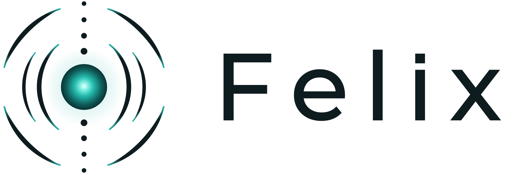
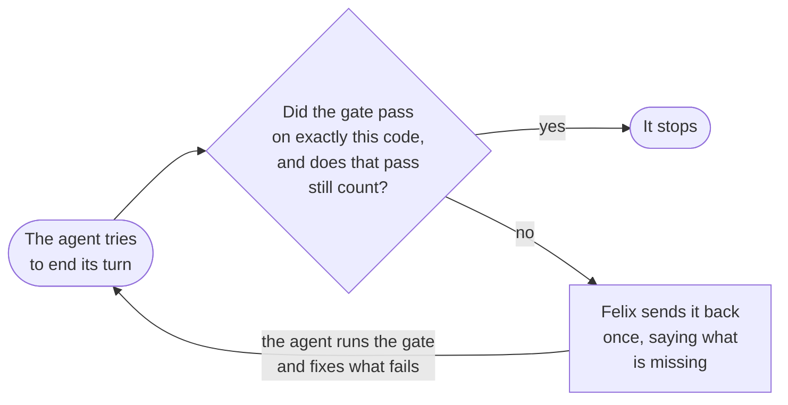

<div align="center">

<picture>
  <source media="(prefers-color-scheme: dark)" srcset="assets/felix-lockup-dark.svg">
  
</picture>

### Your agent says the work is done. Felix checks.

One instruction to a coding agent can turn into two hundred turns of work that nobody reads.<br>
Felix makes sure the agent doesn't also get to decide when that work is done.

[](https://github.com/LeavesJ/Felix/actions/workflows/suite.yml)
[](#install)
[](engine/harness)
[](https://github.com/LeavesJ/Felix/blob/main/LICENSE)

**[How it works](#how-it-works)** &nbsp;·&nbsp; **[Try it](#try-it)** &nbsp;·&nbsp; **[Limits](#why-you-might-not-want-felix)** &nbsp;·&nbsp; **[Status](#status)** &nbsp;·&nbsp; **[Where it's going](#where-its-going)** &nbsp;·&nbsp; **[Install](#install)**

</div>

## The problem

You ask a coding agent to add Google login. It spends two hundred turns on it,
runs the tests about halfway through, and keeps editing after that. Then it
tells you everything passes. It did pass, on code that no longer exists.

The agent did the work, checked its own work, and decided it was finished.
Felix takes the last of those jobs away from it. When a session that changed
code tries to stop, Felix compares the code in front of it with the last time
your project's own checks ran. If they don't match, or the checks failed, it
sends the agent back.

Across 43 of my sessions between August 10 and September 21, 2026, Felix held
an agent's attempt to stop **206** times. In **135** of those holds the checks
had last run on different code. In **39** they had never run in that checkout,
which is where a fresh worktree starts. In **29** they had failed on the exact
code the agent was stopping on. When a hold sent the agent back to run them, at
least 15 of the roughly 130 reruns failed, each one a stop on code that didn't
pass.

I built Felix for my own work, which is one person, a handful of repositories,
and agents doing most of the engineering. Most of Felix was written by the
agents it governs, under its own gate.

## How it works

Your project names a **gate**: one command that proves it correct, like
`npm run verify` or `cargo test`. Each time the gate runs, Felix writes a
**receipt** saying exactly which code it ran on and whether it passed. When an
agent that changed the code tries to end its turn, Felix reads that receipt.



The message the agent gets begins like this:

```
The gate last ran at 2026-09-19T20:37:10Z, on a different tree. It has not seen this work.

Do not describe this work as complete until it has passed.

  felix gate
```

<details>
<summary>The whole message</summary>

```
The gate last ran at 2026-09-19T20:37:10Z, on a different tree. It has not seen this work.

Do not describe this work as complete until it has passed.

  felix gate

If you have already decided to stop with a red gate, that is the founder's call
to make, not yours: they can set FELIX_ALLOW_RED=1 in the environment they
launch a session from. If the red is one TASK_BLOCKING obligation, the narrower
way past it is a row in the project's exceptions.tsv, keyed to that obligation
and dated, merged by a person; a session cannot grant itself one.
```

</details>

A pass stops counting when the code changes (the commit, any uncommitted edit,
or any new file), when something outside the code that the project asked Felix
to watch appears or disappears, like a deployed route, or when someone edits
the project's rules. Felix holds each stop attempt once and
records it. An agent that tries again straight away is let go, and the record
shows it (see [the limits](#why-you-might-not-want-felix)).

The Stop hold is the center of Felix. Around it:

| What Felix does | How, exactly |
|:---|:---|
| **Treats "couldn't check" as "no"** | An **obligation** is something a project must satisfy before it ships, with one command that says whether it applies and another that says whether it's met. If the first command is missing, can't run, or exits with anything but yes or no, the obligation is UNKNOWN, and UNKNOWN blocks ([obligations.sh](engine/harness/lib/obligations.sh)) |
| **Hands what a revert can't undo to a person** | At merge, `felix merge` sorts a change by what a revert can't undo: a credential in the added lines, a change to a workflow (workflows run with the repository's secrets), a change to the autonomy grant or the exception table, a migration or destructive SQL, and a change that removes rows from an enforcing table. Those go to a person |
| **Never lets a change judge itself** | A change to Felix itself is judged by the copy of Felix on main, never by the candidate ([resolve.sh](engine/harness/lib/resolve.sh)). That rule came from one day on which nine engine changes in a row were each deployed before being judged, so each one judged itself |
| **Makes a checker prove it can fail** | For each checker a project declares, `felix qualify` plants six mutations of the thing it protects and requires the checker to fail or pass as each mutation demands ([qualify.sh](engine/harness/lib/qualify.sh)) |
| **Reads plugins before installing them** | Plugins Felix finds on its own are fetched at a pinned commit and read before anything installs. A hook, a floating version or an interpolated secret marks one high risk, and high risk never installs ([discover.sh](engine/harness/lib/discover.sh)). That check says of itself that it "catches carelessness, not an attacker" |
| **Refuses what the project forbids** | Before a tool runs, Felix checks the command, or the file path for an edit, against the project's `deny.tsv` |

### The words, in plain English

| Felix says | It means |
|:---|:---|
| gate | The one command that proves your project correct |
| tree | The code as it stands: the last commit, every uncommitted edit and every new file |
| receipt | The record of a gate run: which tree it ran on, and whether it passed |
| stale | A receipt that no longer counts, because since it was written the tree changed, something the project watches appeared or disappeared, or the project's rules changed |
| probe | A question Felix asks about something outside the code, like whether a route is deployed |
| obligation | Something a project must satisfy before it ships, with a command that checks it |
| UNKNOWN | Felix couldn't find out. It blocks exactly like a failure |
| hold | A stop attempt Felix sent back |

## Try it

The first two cost nothing.

| | What it does | What it changes |
|:---|:---|:---|
| **Audit your past sessions** | Reads the transcripts Claude Code already keeps under `~/.claude/projects` and counts how often a turn stopped right after an edit that no check had run on | Nothing. It installs nothing and writes nothing |
| **Govern one project** | Writes one project's rules and a guessed gate, so `felix gate` works straight away | A few files and a marker. No plugins, no network |
| **Install the plugin** | Holds stops in the sessions of every project Felix governs | Your Claude Code setup. [Read what it changes](#install) first |

The audit:

```bash
git clone https://github.com/LeavesJ/Felix.git felix
felix/engine/harness/felix audit
```

It runs bash, which `felix` finds through `/usr/bin/env`, and awk, and
`readlink` only where `felix` is reached through a symlink. It doesn't need the
`claude` CLI.

<details>
<summary>What the audit counts, exactly</summary>

Each stop after an edit falls into one of four classes. The last check after
the last edit reported no error, or it failed, or a check ran earlier but not
since the last edit, or no check the roster recognises had run in the session
at all. A check is a Bash command that runs tests or a gate through a runner
the roster names, and it names many but not all of them. `--verify ERE` adds a
project's own, for every project a run reads (give `--dir` one project's
directory to narrow it), and `--since YYYY-MM-DD` counts only the stops from
that day on, each still read against its whole session. A check piped into
another command, followed by one, run in the background or turned over by `!`
hands its exit status to something else, so its own failure goes unseen, and
the report says how many of the passing ones that covers. It doesn't read
subagent transcripts, and it leaves out edits to scratch files, to anything
under Claude's configuration directory (memory, plans, settings, skills, hooks)
and to Felix's memory, since no gate covers those: files under `/tmp` or
`$TMPDIR`, under `$CLAUDE_CONFIG_DIR` (by default `~/.claude`) and under
`$FELIX_MEMORY` (by default `~/.felix/memory`). An edit is Claude's Edit,
Write, MultiEdit or NotebookEdit tool, or a Bash command that writes a file in
place: `sed -i`, `perl -i`, a `>` or `>>` or `tee` to a named path, `patch` or
`git apply`. Other writes through Bash are not seen.

</details>

Governing one project without commissioning it:

```bash
cd your-project
/path/to/felix/engine/harness/felix new your-project --no-commission
```

<details>
<summary>What that writes</summary>

That writes the project's rules, a guessed gate, a memory directory under
`~/.felix/memory` and a `.felix` marker in the checkout. It installs no plugins
and uses no network. From a plain clone the rules go into the clone's own
`projects/` directory, because a clone that ships `projects/` is Felix's home.
`felix which` works straight away, and so does `felix gate` where a gate was
guessed. The hooks come with the plugin, so where a gate was guessed, its
sessions are held once `felix install` has run; where none was, set `gate` in
`project.json` first. `felix commission` runs commissioning whenever you want
it.

</details>

## Why not just run the tests in CI?

You should, and Felix can set that up for you. CI checks what gets pushed.
Code review checks what someone reads. Neither sees the moment an agent
decides it's finished and says so. A twenty-line Stop hook that runs `npm test`
gets you part of the way. Felix adds three things that hook doesn't have:

1. **A receipt for the exact tree.** Every gate run is recorded against HEAD,
   the full diff, and each untracked file's name, size and modification time.
   An edit to any of those makes the old pass stop counting. (Git-ignored files
   aren't part of it, and past 500 untracked files only their count is.)
2. **Staleness from outside the tree.** A project can declare probes: commands
   that each ask one question of the world outside the code, like whether a
   route is deployed. If a probe starts or stops finding what it asks about,
   finds a different number of them, or is answered by a different build of
   its program, the old pass stops counting, even though no file changed. The
   same goes for the project's policy tables and target branch.
3. **"Couldn't check" counts as a failure.** If an obligation's commands are
   missing, can't run, or can't answer yes or no, the obligation is UNKNOWN,
   and UNKNOWN blocks. Until September 16 a crashing `applies` command read as
   "does not apply" and retired a blocking obligation. The comment that
   records it is still in [obligations.sh](engine/harness/lib/obligations.sh).

## Why you might not want Felix

> [!IMPORTANT]
> Felix is a floor, not a wall. It stops an agent that forgets, not one that's
> trying to get round it.

Felix's hooks run inside the agent's own session. The Stop hook holds each stop
attempt once and records it, and calls itself "a speed bump with a permanent
record, not an inescapable barrier". Receipts are plain files a process running
as you could write. And `gh pr merge` skips `felix merge` entirely.

The deny table has the same weakness from the other side. Its rules fired 93
times in the six weeks, and most of that record is Felix testing itself:
payloads piped into the hook by hand, sessions building throwaway repositories,
and text that merely named a refused command. Only a handful were an agent
doing the refused thing in earnest, and none of those was a force push. A regex
over command text refuses spellings, not intent.

The wall is a required CI check that reruns `felix gate` on the pushed tree, on
a branch admins can't bypass, with Felix fetched from a repository the agent
can't push to. `felix bootstrap --yes` writes the workflow and a branch rule
that requires it, but leaves admins able to bypass the rule. Of the five
repositories Felix governs today, one has the whole wall, and Felix's own isn't
it.

It's also young and has one maintainer, and it runs only on Claude Code.
Nothing yet shows that governed sessions ship fewer defects than ungoverned
ones, and the numbers above can't show it. If you want a mature, general agent
framework, this isn't one.

## Status

| State | What |
|:---|:---|
| **In daily use** on my projects | The Stop hold, receipts and their staleness, the merge escapes, obligations with UNKNOWN blocking, project setup (commissioning), the deny table, checker qualification on Felix's own checks, plugin discovery, and the ledger of which tools sessions used |
| **Built, barely exercised** | Exceptions (none granted yet), the unattended repair workflow (never run on real input), and obligations proposed by a model (run once on one real project; none admitted yet, since only a person can admit one) |
| **Partial** | Pinning the judge to main covers `felix merge` but not `felix gate`. Auto-merge keys on a CI streak rather than on obligations. The staleness hash depends on which `git` is on PATH, so the same tree can read stale in another environment |
| **Designed, not built** | `felix dispatch`, which runs each worker as a restricted headless session with only the tools its task needs, and records what it did |
| **Absent** | Sandboxing, time-limited tool grants and revocation, and support for any host but Claude Code |

## Where it's going

The aim is a control plane for autonomous engineering, in two halves. The
**capability plane** gets work done: what engineering a project needs, who can
provide it, how well it did, and when to retire it. The **trust plane** decides
when there's enough evidence to trust the result: what is known and unknown,
what was proven against which revision, and who may release. You state intent
and make the decisions that are yours. Workers do the engineering in narrow,
disposable sessions. Felix decides what counts as done.

Most of what's built today is the trust half. Here is one change followed from
start to finish, with what exists now marked against each step:

| Step | Today |
|:---|:---|
| You ask an agent to add money transfers. It writes them, runs some tests, and says it's done | |
| Felix sends it back: the gate hasn't passed on this code | **Built** |
| The project lists "the same payment can't go through twice" as something that must hold before it ships, with the command that checks it. Until a real check exists, that command can't answer, so the item is UNKNOWN, and UNKNOWN blocks | **Built.** A person writes the item and its check. A model can suggest items, but only as advice |
| Felix works out for itself that transfers need that check, and finds or builds something that can run it | **Not built.** This is the capability plane |
| Someone writes the concurrency test. The gate runs it, it passes, and the receipt names the exact code it judged | **Built** |
| The next day the transfer logic changes. That receipt belonged to the old code, so it stops counting, and the agent is sent back to run the gate again | **Built** |
| `felix merge` refuses the branch unless the gate is green and current on it and every release-blocking item is met. A credential in the diff, a workflow change or a database migration goes to a person, whatever the tests say | **Built** |
| Deploy and release | **Not built.** Felix stops at merging a pull request |

The first piece of the capability plane will be `felix dispatch`, which runs
one worker per lease, launched with only the tools its task needs, with its
record as the handoff. The first version launches Claude Code headless, though
the shape itself isn't specific to Claude. The bet is on models getting better:
as workers take on more of each instruction, it matters more that something
other than the worker decides what counts as done.

Two things here aren't new. [AI-SDLC](https://ai-sdlc.io) also binds verdicts
to commits, and GitHub's
[Agent HQ](https://github.blog/news-insights/company-news/pick-your-agent-use-claude-and-codex-on-agent-hq/)
also governs several agent vendors from one place.

## Install

Installing changes your setup, so read this part first:

- The plugin loads in every Claude Code session on the machine and records
  which tools each session calls.
- In a governed project it also logs the start of each prompt to the project's
  memory directory, clones candidate plugins once a week to read them, and adds
  catalogue rows for tools it detects.
- `felix install` may bump the patch version in
  `engine/.claude-plugin/plugin.json`.
- Governing a project installs plugins at user scope (below).
- Nothing merges on its own. `felix merge` and `felix automerge` run only when
  you call them.

To look without committing, point `HOME` at a scratch directory for every
command (you'll need to sign in to `claude` there), skip the symlink, and
govern a scratch repository. `FELIX_HOME` and `FELIX_MEMORY` move Felix's own
files but not the plugins.

Requires bash 3.2 or later, git and the `claude` CLI. `gh` is needed for
`brief`, `pr`, `merge`, `automerge`, `repair`, `bootstrap`, `unattended`,
`classify --apply` and `incident --create`. Commissioning and discovery use the
network, and `felix pulse --install` is macOS only.

```bash
git clone https://github.com/LeavesJ/Felix.git felix
felix/engine/harness/felix install
ln -s "$PWD/felix/engine/harness/felix" /usr/local/bin/felix
```

Then govern a project:

```bash
cd your-project
felix new your-project
```

If the guessed gate is empty, set `gate` in `project.json` to any shell command
that proves the project correct. Run `felix` with no arguments for every
command, grouped, or `/felix` inside Claude Code.

<details>
<summary>What <code>felix install</code> and <code>felix new</code> do</summary>

`felix install` registers the checkout as a local plugin marketplace, installs
the plugin at user scope, and checks that what Claude Code deployed matches the
tree. Claude Code caches plugins by version, so an engine changed at the same
version would otherwise fail to deploy while reporting success. On drift,
install bumps the patch version and redeploys (`--no-bump` turns that off).
Install from a main checkout, never a git worktree, which would point the
marketplace at the worktree. A clone that ships `projects/` becomes Felix's
home, the directory that holds each project's rules, and is itself governed as
the project `felix`.

`felix new` writes the project's rules into the home, a memory directory under
`~/.felix/memory`, and a `.felix` marker in the checkout, and guesses a gate.
Then it commissions the project. Commissioning registers Anthropic's official
plugin marketplace and installs at user scope the catalogue's low-risk plugins
for every project, currently superpowers, claude-md-management,
claude-code-setup, context7, code-review, security-guidance and
code-simplifier. It also installs catalogue rows matching what it detects in
the checkout, and low-risk plugins discovery has read. High-risk rows such as
semgrep wait for a person. `felix new your-project --no-commission` skips
commissioning, and `felix commission` runs it later.

</details>

### Verify and uninstall

```bash
felix gate                  # this project's gate, recorded as a receipt
engine/harness/tests/run    # the engine's own suite, about 3,000 assertions
```

The suite drives the real CLI and hooks against an invented project in a
throwaway root, and fails if any assertion in its manifest was never reached.

`felix install --uninstall` removes the plugin and nothing else, because Felix
never deletes your rules or memory. The rest is by hand:

- `felix pulse --uninstall`, if you installed the schedule
- `claude plugin uninstall` for each plugin commissioning added that you didn't
  already have
- `claude plugin marketplace remove felix`, and `claude-plugins-official` if
  commissioning added it
- delete `~/.felix-home`, the symlink and each repository's `.felix` marker,
  and `~/.felix` too if you want the memory gone

## Under the hood

<details>
<summary><b>Hooks</b>: the eight Claude Code events Felix binds</summary>

[hooks.json](engine/hooks/hooks.json) binds eight events:

| Event | What Felix does |
|:---|:---|
| Session start | Names the project's constitution (its CLAUDE.md of standing rules) and handoff to read, and reports due upkeep. Records tools the checkout has grown by adding their catalogue rows, without installing anything. Refreshes discovery weekly in the background |
| Prompt | Mounts recorded lessons that match the prompt, and names a tool on the first routed turn. Logs the first 160 characters of each prompt, and up to 200 beside anything Felix says, to the project's memory directory |
| Before a tool call | Refuses what the project's `deny.tsv` names, with the reason. A new project has no rows |
| After a tool call | Appends one ledger line. Async, never blocks |
| Subagent start | Tells the subagent the project, its constitution and its gate |
| Subagent stop | Once per session, if the checkout holds changes no gate has passed, tells the parent that a subagent's report must call its own changes unverified |
| Session end | Folds the session into the ledger, with a zero for every declared tool never used |
| Stop | If the session changed the code, holds the stop once unless a receipt for this exact tree is green and still current |

Four other events are declined, each with its reason, in
[lifecycle.tsv](engine/harness/templates/lifecycle.tsv).

</details>

<details>
<summary><b>Before and after</b>: my sessions, measured from their transcripts</summary>

Claude Code keeps every session's transcript on disk, so I measured my own work
before and after Felix. The table counts only prompts typed by hand, leaves out
automated sessions, and keeps sessions whose main model was Opus 5. Their
subagents still ran other models, about 28% of turns before and 18% after.

| Per prompt typed by hand | Ungoverned, Jul 24 to Aug 10 (21 sessions, 246 prompts) | Governed, Sep 4 to 21 (16 sessions, 116 prompts) |
|:---|:---|:---|
| Model turns | 78 | 215 |
| Tool calls | 86 | 278 |

Most of that jump isn't Felix. My use of Claude Code's Workflow tool grew over
the same weeks and accounts for nearly all of the extra turns. Every session
after August 29 was governed, so there are no ungoverned sessions from those
weeks to compare against. What the table does show is the problem. On average,
one instruction now fans out into about two hundred model turns and nearly
three hundred tool calls (the median session runs nearer 120 turns per
prompt), and nobody reads that. The holds above are what a gate does with it.

Over the whole period, June 22 to September 21, the transcripts hold 1,031
prompts typed by hand, 87,130 model turns and 109,055 tool calls. The analysis
scripts read those transcripts directly and aren't published, because the
transcripts are private.

</details>

<details>
<summary><b>Ideas it dropped</b>: tool routing, and a rewrite out of bash</summary>

Felix used to point every session at the skill or plugin it thought the prompt
needed. A blind study of 158 real prompts put that advice at about 2%
precision. A tool actually applied on only 8 of them, which makes it a
direction rather than a measurement. Over five days the advice was followed 2
times out of 11, and all three mandates audited live were wrong for their turn.
The same five-day audit found the part that worked: every Stop hold it checked
was correct. Felix now names a tool on a session's first routed turn, and again
only when that route's next step comes due, and asks for a recorded decline
when it doesn't fit.

A proposal to move the engine's record-keeping out of bash into a typed
language was dropped the same way. Of 159 recorded lessons, 36 were strictly
caused by the language, and a typed kernel would have prevented 26 of them.
That wasn't enough to justify the move.

</details>

<details>
<summary><b>Built for better models</b>: which parts should outlive today's agents</summary>

[Every part of a harness encodes an assumption about what the model can't
do](https://www.anthropic.com/engineering/harness-design-long-running-apps),
and those assumptions go stale. An outside review put that question to Felix:
if the model were ten times better tomorrow, which parts would still need to
exist?

The rules and the judge. Receipts bound to a tree, UNKNOWN blocking,
exceptions only a person can make effective, the merge escapes, checks that
must prove they can fail, and the record of every refusal. A smarter model
still shouldn't grade its own work. The parts that compensate for today's
models should go, starting with keyword routing, which the study above already
demoted, along with the reminders to read the handoff and the notes injected
into subagents. Nobody has tested the first list against a capable agent trying
to get round it.

</details>

---

<div align="center">
<sub>Apache-2.0</sub>
</div>
